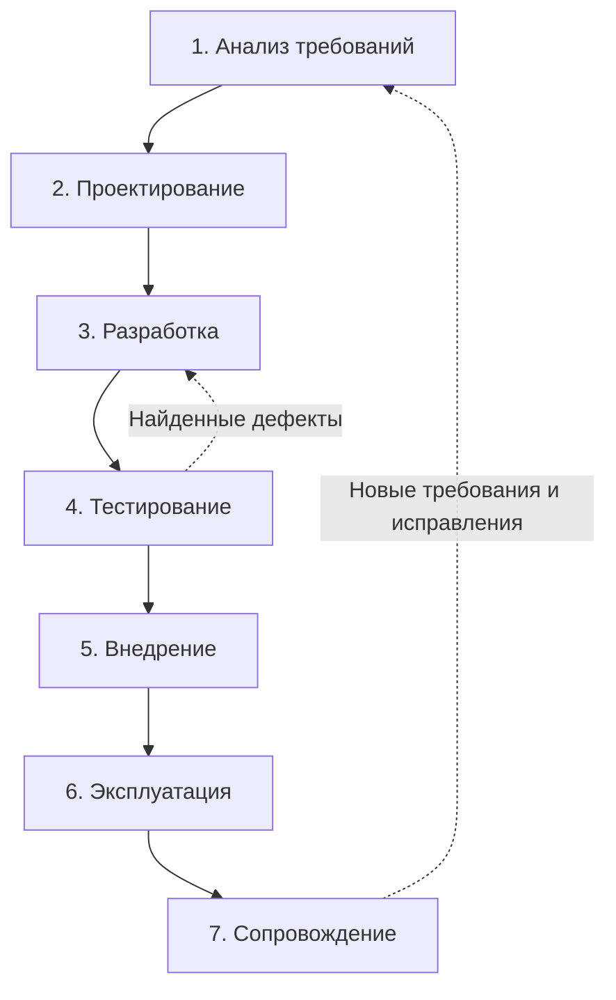

# Практическая работа № 1

**Дисциплина:** Технологии разработки программного обеспечения  
**Тема:** Жизненный цикл программного обеспечения  
**Объект исследования:** Smart Qala (VoiceOfSemey), демонстрационная веб-платформа города Семей  
**Дата:** 8 октября 2026 года

## Тема

Жизненный цикл программного обеспечения на примере проекта Smart Qala.

## Цель

Изучить основные процессы и этапы жизненного цикла ПО; построить модель жизненного цикла Smart Qala, указав для каждого этапа входные данные, работы и результат. Разграничить реализованный прототип и предлагаемые дальнейшие этапы.

## Теоретические сведения

Жизненный цикл программного обеспечения — совокупность процессов от появления потребности в системе до прекращения её эксплуатации. Он включает анализ требований, проектирование, разработку, тестирование, внедрение, эксплуатацию и сопровождение. Результат одного этапа служит входом для следующего, а обнаруженные ошибки или новые требования могут вернуть проект к пересмотру предыдущих решений.

**Анализ требований** определяет пользователей, задачи и ограничения. **Проектирование** описывает данные, модули, интерфейсы и взаимодействия. **Разработка** превращает проектные решения в код. **Тестирование** сопоставляет поведение программы с требованиями и выявляет дефекты. **Внедрение** готовит сборку, окружение и выпуск. **Эксплуатация** означает использование системы и наблюдение за её состоянием. **Сопровождение** включает исправления, адаптацию и развитие после выпуска.

Жизненный цикл не равен одной конкретной модели разработки. Каскадная, V-образная, инкрементная, эволюционная и спиральная модели по-разному организуют те же процессы. Для этой работы построена **логическая схема этапов** Smart Qala; она не утверждает, что команда исторически проходила их именно в таком порядке.

## Задание

Выбрать информационную систему, определить её назначение и пользователей, выделить этапы жизненного цикла. Для каждого этапа указать входную информацию, работы и результат. Представить последовательность этапов графически. В качестве единого объекта для практических работ № 1–15 выбран Smart Qala.

## Ход выполнения

### 1. Предметная область и назначение

Smart Qala — демонстрационная веб-платформа для приёма обращений жителей Семея о городских проблемах и идей по улучшению городской среды. В исходном коде есть форма обращения, карточки заявок, банк идей, карта и интерфейс обработки заявок. Цепочка предметной задачи: житель описывает проблему → приложение анализирует текст → сохраняет запись → сотрудник меняет статус и публикует ответ. Фактической интеграции с городскими службами и постоянной базой данных нет.

### 2. Пользователи

- **Житель (`citizen`)** — предполагаемый пользователь формы обращения, идей, карты и карточек.
- **Сотрудник службы (`employee`)** — предполагаемый пользователь панели обработки заявок.
- **Администратор (`admin`)** — предполагаемый пользователь функций модерации и контроля.
- **Гость** — демонстрационный режим интерфейса; в типах проекта он не является отдельной ролью.

Роли и вход сейчас задаются клиентским состоянием и `localStorage`; серверные API не проверяют полномочия. Поэтому перечисление ролей описывает сценарии интерфейса, а не защищённую систему доступа.

### 3. Что уже имеется в проекте

**Таблица 1 — Артефакты текущего кода, использованные в модели.**

| Артефакт текущего кода | Использование в модели жизненного цикла |
|---|---|
| `src/types/index.ts`: `CityRequest`, `UserProfile`, статусы и роли | Основа модели данных и требований к сущностям |
| `src/app/create/page.tsx` и `src/app/api/requests/route.ts` | Сценарий ввода и создания обращения |
| `src/lib/ai-service.ts` | Анализ текста через Gemini при наличии ключа либо локальные правила |
| `src/lib/mock-data.ts` | Демонстрационные записи и хранение в памяти процесса |
| `src/app/admin/page.tsx`, `src/app/map/page.tsx`, `src/app/ideas/page.tsx` | Интерфейсы обработки, карты и идей |
| `SMART_QALA_PROJECT_INFO.md` | Проверенное описание архитектуры и ограничений прототипа |

### 4. Этапы жизненного цикла Smart Qala

**Таблица 2 — Входы, работы и результаты этапов жизненного цикла.** Под «результатом» понимается ожидаемый артефакт этапа, если прямо не сказано, что он уже существует.

| Этап | Входная информация | Основные работы | Результат и текущий статус |
|---|---|---|---|
| 1. Анализ требований | Потребность жителей сообщать о проблемах; существующий код и типы | Уточнить сценарии жителя и сотрудника, правила статусов, требования к защите данных и хранению | Перечень проверяемых требований. Первичный анализ зафиксирован в `SMART_QALA_PROJECT_INFO.md`; формальной согласованной спецификации нет |
| 2. Проектирование | Требования и сценарии | Описать модули Next.js, сущности, HTTP API и границы доступа; отделить текущую in-memory модель от будущего постоянного хранения | Архитектурные схемы и спецификации. Модули и типы существуют в коде; защищённая серверная модель доступа не реализована |
| 3. Разработка | Проектные решения и TypeScript-типы | Реализовать формы, API, обработку текста, карту и панель; согласовать интерфейсы компонентов | Код прототипа имеется. Текущая рабочая копия содержит несовместимость `AppContext.tsx` с использующими его компонентами |
| 4. Тестирование | Код, требования и сценарии | Проверить типы, линтер, сборку и пользовательские сценарии; устранить найденные дефекты | Протокол проверок. На 08.10.2026 TypeScript-проверка не проходит; ESLint: 9 ошибок и 54 предупреждения; автоматических тестов нет |
| 5. Внедрение | Проверенная сборка и конфигурация окружения | Подготовить переменные среды, выпуск и план отката | Развёрнутый выпуск и инструкция запуска. Продакшн-развёртывание не подтверждено; запуск `next build` в песочнице остановлен ограничением на открытие порта |
| 6. Эксплуатация | Развёрнутый выпуск и пользователи | Принимать обращения, наблюдать за доступностью, сохранять данные и события | Работающий сервис с измеримыми показателями. Реальная эксплуатация не подтверждена; данные прототипа находятся в памяти процесса |
| 7. Сопровождение | Ошибки, обратная связь и новые требования | Исправлять дефекты, повторять проверки, развивать функции и документацию | Исправленные версии и актуальные отчёты. Первый установленный приоритет — согласовать `AppContext.tsx` с компонентами и повторить проверки |

### 5. Графическая модель

**Рисунок 1 — Логическая схема жизненного цикла Smart Qala.**

Стрелка обратной связи показывает, что замечания эксплуатации и сопровождения могут изменить требования к следующей версии.

## Результаты

Определены предметная область, четыре пользовательских режима, семь процессов жизненного цикла и артефакты каждого этапа. Модель связана с реальными файлами Smart Qala. Отдельно установлено, что приложение пока нельзя характеризовать как проверенный внедрённый сервис: в текущем дереве есть ошибки типов, серверной авторизации и постоянного хранилища нет. Схема служит планом разработки и проверки, а не отчётом о завершённом внедрении.

## Вывод

Жизненный цикл позволяет связать требования к городской платформе с проектированием, кодом, проверками и дальнейшим сопровождением. Для Smart Qala исходный код уже даёт материал для моделирования, но переход к внедрению требует устранить текущие ошибки типов, проверить сценарии, определить безопасное хранение данных и серверный контроль доступа. Эти работы являются будущими задачами, а не реализованными свойствами прототипа.

## Ответы на контрольные вопросы

**1. Что понимается под жизненным циклом ПО?** Совокупность процессов и работ от возникновения идеи и требований до прекращения использования и сопровождения системы.

**2. Какие основные процессы входят в жизненный цикл?** Анализ требований, проектирование, разработка, тестирование, внедрение, эксплуатация и сопровождение. В конкретной модели они могут повторяться и перекрываться.

**3. Чем разработка ПО отличается от его сопровождения?** Разработка создаёт новую функциональность и первоначальный продукт по заданным требованиям. Сопровождение ведётся после выпуска: исправляет дефекты, адаптирует и улучшает уже используемую систему. Для Smart Qala текущие ошибки типов относятся к задачам исправления прототипа; факт его промышленной эксплуатации не установлен.

**4. Какие существуют модели жизненного цикла?** Каскадная, V-образная, инкрементная, эволюционная, спиральная и RAD. Они различаются порядком этапов, частотой обратной связи и управлением изменениями и рисками.

**5. Почему выбор модели зависит от характеристик проекта?** Модель должна соответствовать стабильности требований, рискам, требуемой скорости выпуска и доступности обратной связи. У Smart Qala есть неопределённости по защите персональных данных, постоянному хранению и реальной интеграции со службами; поэтому окончательный выбор модели требует оценки этих условий, которая рассматривается в следующих практических работах.

## Использованные материалы

1. «Практические работы ТРПО.docx», практическое занятие № 1: тема, цель, порядок выполнения и контрольные вопросы.
2. `SMART_QALA_PROJECT_INFO.md` — проверенное состояние проекта на 08.10.2026.
3. Исходный код Smart Qala: `src/types/index.ts`, `src/lib/mock-data.ts`, `src/lib/ai-service.ts`, `src/context/AppContext.tsx`, `src/app`.
