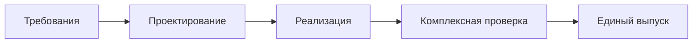
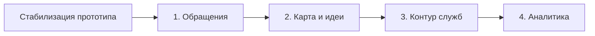

# Практическая работа № 2

**Дисциплина:** Технологии разработки программного обеспечения  
**Тема:** Стратегии разработки программного обеспечения  
**Объект исследования:** Smart Qala (VoiceOfSemey), демонстрационная веб-платформа города Семей  
**Дата:** 8 октября 2026 года

## Тема

Каскадная, инкрементная и эволюционная стратегии разработки на примере Smart Qala.

## Цель

Изучить три стратегии разработки ПО, построить для одного проекта альтернативные планы работ, сравнить их по критериям методических указаний и обосновать подходящий вариант дальнейшего развития Smart Qala.

## Теоретические сведения

**Стратегия разработки** определяет, как организуются работы над продуктом и когда пользователи получают результат. Она задаёт порядок выполнения задач, способ обработки изменяющихся требований и моменты обратной связи. Стратегия описывает план развития, а не перечень уже реализованных функций.

**Каскадная стратегия** проводит проект через последовательно утверждаемые этапы: требования, проектирование, реализацию, проверку и выпуск. Она удобна при стабильных требованиях и чётких критериях приёмки, но поздние изменения обходятся дорого. **Инкрементная стратегия** делит функциональность на законченные части — инкременты. Каждая часть проектируется, реализуется и проверяется; следующий инкремент расширяет предыдущий. **Эволюционная стратегия** использует работающий прототип, обратную связь и повторное уточнение требований. Состав следующей версии определяется результатами проверки предыдущей.

Инкрементальная работа отвечает прежде всего на вопрос «какую заранее выделенную функцию добавить следующей?». Эволюционная работа отвечает на вопрос «что следует изменить после изучения прототипа и отзывов?». На практике при разработке одной системы их приёмы могут сочетаться, но в этой работе варианты сравниваются отдельно.

## Задание

Для Smart Qala описать исходные требования; построить каскадную схему; выделить инкременты и их последовательность; описать эволюционный вариант; сравнить три стратегии по изменению требований, риску, сроку получения результата, участию заказчика, стоимости изменений и области применения.

## Ход выполнения

### 1. Исходные требования и состояние проекта

Предметная задача Smart Qala едина для всех трёх вариантов: житель сообщает о городской проблеме либо предлагает идею, запись классифицируется и становится доступной для просмотра и обработки. Пользовательские режимы: житель (`citizen`), сотрудник (`employee`), администратор (`admin`) и демонстрационный гостевой вход. Роли в нынешнем прототипе задаются на клиенте, а не проверяются API.

**Таблица 1 — Исходные требования и найденные в коде основания.**

| Требование | Что подтверждено исходным кодом | Что остаётся условием выпуска |
|---|---|---|
| Приём обращения или идеи | Форма `/create`, POST `/api/requests`, тип `CityRequest` | Проверка данных и сценариев после исправления текущих ошибок типов |
| Классификация обращения | `/api/ai`, Gemini при наличии ключа, локальный fallback | Контроль качества результатов и обработка ошибок |
| Просмотр и общественная поддержка | Карточки, `/ideas`, `/map`, API голосования | Серверная защита от повторных голосов и проверка доступа к данным |
| Работа сотрудников и модерация | Интерфейс `/admin`, PATCH заявки, официальные сообщения | Серверная аутентификация, авторизация и журнал действий |
| Долговременная эксплуатация | Демонстрационные данные в `mock-data.ts` | Постоянное хранилище, резервирование, проверенная сборка и развёртывание |

Факты из таблицы описывают код, а не подтверждённую работоспособность всех сценариев. На 08.10.2026 текущий `AppContext.tsx` несовместим с использующими его компонентами, поэтому TypeScript-проверка не проходит; линтер сообщает 9 ошибок. До любой демонстрации очередной версии требуется устранить эту несогласованность и повторить проверки. Ниже приведены **альтернативные планы**, а не история реально выполненных этапов.

### 2. Каскадный вариант

Сначала фиксируются требования к приёму обращений, ролям, хранению персональных данных, статусам и приёмке. Затем проектируются API, постоянное хранилище и контроль доступа. После утверждения проекта реализуются недостающие части и исправляется текущий прототип. Только после комплексного тестирования готовится единый выпуск.

**Рисунок 1 — Каскадный план разработки Smart Qala.**

**Результат варианта:** один кандидат на выпуск после выполнения всех требований. Существующие страницы и API используются как исходный материал для проектирования и реализации; наличие их файлов не заменяет приёмочные проверки. Главный недостаток для Smart Qala — поздняя проверка пользовательских сценариев и требований к приватности.

### 3. Инкрементный вариант

Общий подготовительный шаг для всех инкрементов: согласовать `AppContext.tsx` с компонентами, добиться успешной проверки типов, устранить блокирующие ошибки линтера и определить критерии приёмки. Это стабилизация текущей рабочей копии, а не новая функция.

**Инкремент 1 — обращения.** Проверить форму `/create`, `/api/ai`, создание записи и карточку `/requests/[id]` на демонстрационных данных. Результат — внутренне проверяемый сценарий «от текста до карточки»; открытый выпуск с персональными данными пока не допускается.

**Инкремент 2 — публичное взаимодействие.** Проверить карту `/map`, банк идей `/ideas` и голосование. Для реального использования добавить серверное ограничение повторных голосов и исключить выдачу персональных полей из публичного API. Результат — проверенный публичный просмотр без раскрытия данных заявителей.

**Инкремент 3 — работа служб.** Проверить `/admin`, изменение статуса, модерацию и официальную переписку. До предоставления доступа сотрудникам необходимы серверная аутентификация, разграничение полномочий и постоянное хранилище. Результат — кандидат на служебный контур после проверки безопасности и сохранности данных.

**Инкремент 4 — аналитика и сопровождение.** Проверить `/analytics`, заменить константу среднего срока решения фактическим расчётом, определить наблюдение за сервисом и резервное копирование. Внешняя интеграция со службой 109 может быть отдельным последующим инкрементом только после согласования её API и требований.

**Рисунок 2 — Последовательность инкрементов Smart Qala.**

Каждый инкремент завершается проверкой своей функции и повторной проверкой ранее подготовленных функций. Промежуточные результаты могут оставаться внутренними: решение о публичном выпуске зависит от защиты данных и качества проверок.

### 4. Эволюционный вариант

Отправная точка — имеющийся демонстрационный прототип: формы, API, карта, идеи и панель уже представлены в коде, но текущая сборка не подтверждена. Сначала устраняются блокирующие ошибки и проводится наблюдаемая демонстрация сценария обращения. По результатам отзывов жителей и сотрудников уточняются требования к форме, маршрутизации и карточке. Следующая версия прототипа проверяется повторно; приоритет работ определяется найденными проблемами, а не заранее закреплённым набором функций.

Один возможный цикл: прототип → проверка сценария → обратная связь → пересмотр требований → изменение и повторная проверка. Например, если проверка выявит непонятное описание статуса, изменяется карточка; если обнаружится риск раскрытия контактов, пересматриваются API и правила доступа до следующей демонстрации. Эти примеры показывают правила принятия решения, а не утверждают, что такие отзывы уже получены.

**Рисунок 3 — Цикл эволюционного уточнения Smart Qala.**

**Результат варианта:** последовательность уточняемых версий с подтверждёнными решениями по наиболее существенным проблемам. Риск — труднее заранее зафиксировать полный состав работ и срок финального выпуска; изменения модели данных и защиты доступа требуют отдельного контроля.

### 5. Сравнение стратегий

**Таблица 2 — Сравнение стратегий для Smart Qala по критериям методички.**

| Критерий | Каскадная | Инкрементная | Эволюционная |
|---|---|---|---|
| Изменение требований | Дорого после утверждения | Между версиями | После обратной связи |
| Риск | Выявляется поздно | Снижается по частям | Выявляется на прототипах |
| Срок получения результата | После всех этапов | После первого инкремента | После первого прототипа |
| Участие заказчика | В начале и приёмке | На приёмке версий | На каждом цикле |
| Стоимость изменений | Высокая поздно | Обычно локальная | Зависит от масштаба переделки |
| Область применения | Стабильные требования | Выделяемые функции | Неясные требования |

Для дальнейшего развития Smart Qala предпочтительна **инкрементная стратегия с обязательной обратной связью после каждой версии**: модули уже выделены в коде, а риски доступа и хранения данных можно проверять поэтапно. Это проектная рекомендация, не описание фактически принятого командой процесса. Серверная защита персональных данных и постоянное хранение — условия реального выпуска, а не необязательные улучшения.

## Результаты

На основе одного состава требований построены три альтернативных плана. Для инкрементного плана выделены четыре функциональные части и общий шаг стабилизации. Сравнение показало, когда появляется первый проверяемый результат и как каждый вариант реагирует на изменение требований. Все новые меры безопасности, хранения и эксплуатации обозначены как будущие работы; им не приписан статус реализованных возможностей.

## Вывод

Каскадный вариант удобен при заранее утверждённых и стабильных требованиях, но для Smart Qala отложит проверку сложных сценариев. Эволюционный вариант полезен для уточнения интерфейса и требований на прототипах. Инкрементный вариант даёт понятную последовательность проверки модулей; поэтому он рекомендован как основа дальнейших работ с обратной связью между версиями. Перед любым выпуском необходимо устранить текущие ошибки типов и обеспечить серверный контроль доступа и сохранность данных.

## Ответы на контрольные вопросы

**1. Что такое стратегия разработки?** Это способ организовать создание ПО: определить порядок работ, частоту выпуска результатов, моменты проверки и обработки изменений.

**2. В чём преимущества каскадной стратегии?** Последовательные этапы, заранее определённые результаты и понятные точки утверждения упрощают планирование, если требования стабильны и могут быть достаточно полно описаны до реализации.

**3. Какие недостатки имеет каскадная модель?** Пользователь получает целостный результат поздно; ошибки требований и проектирования могут обнаружиться после значительных затрат; изменение утверждённых решений требует возврата к предыдущим этапам.

**4. Что такое инкремент?** Законченная, проверенная часть функциональности, расширяющая предыдущую версию продукта. Для Smart Qala примером может быть отдельно проверенный сценарий создания обращения; это не означает, что такой выпуск уже состоялся.

**5. Когда целесообразно использовать эволюционную стратегию?** Когда требования нельзя достоверно зафиксировать заранее и их нужно уточнять по результатам испытания прототипа и обратной связи. При этом критические требования безопасности должны проверяться до реального выпуска.

## Использованные материалы

1. «Практические работы ТРПО.docx», практическое занятие № 2: тема, цель, порядок выполнения, критерии сравнения и контрольные вопросы.
2. `SMART_QALA_PROJECT_INFO.md` — проверенное состояние Smart Qala на 08.10.2026.
3. `practice-01.md` — единые предметная область, роли и оценка состояния проекта.
4. Исходный код Smart Qala: `src/types/index.ts`, `src/lib/mock-data.ts`, `src/lib/ai-service.ts`, `src/context/AppContext.tsx`, `src/app`.
