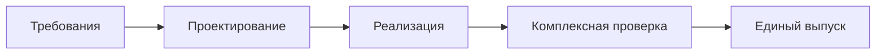
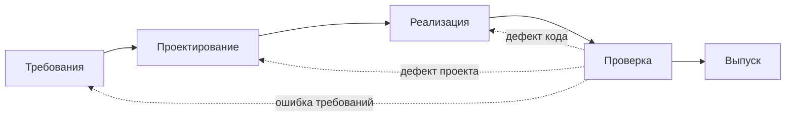
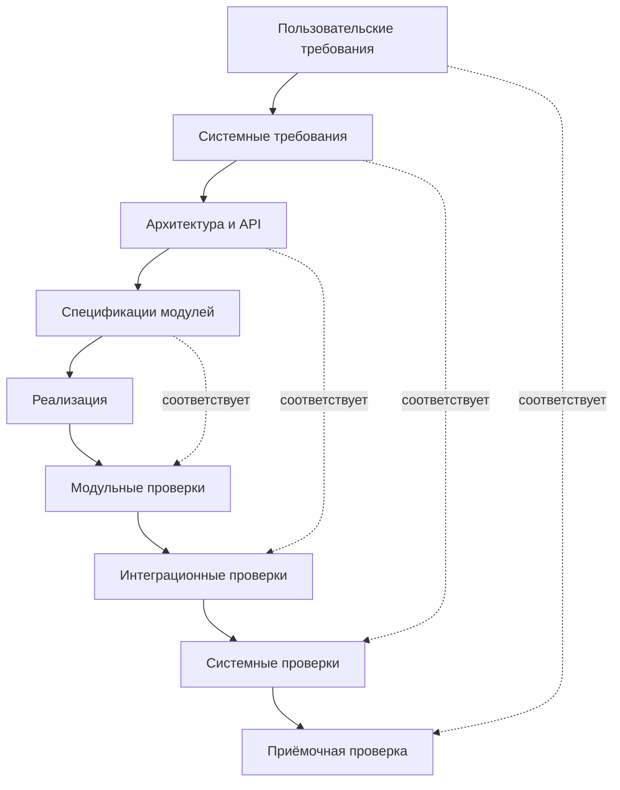

# Практическая работа № 3

**Дисциплина:** Технологии разработки программного обеспечения  
**Тема:** Каскадная и V-образная модели жизненного цикла  
**Объект исследования:** Smart Qala (VoiceOfSemey)  
**Дата:** 8 октября 2026 года

## Тема

Классическая каскадная модель, каскадная модель с обратными связями и V-образная модель на примере Smart Qala.

## Цель

Изучить особенности трёх вариантов организации жизненного цикла, построить их схемы для одной системы и определить, когда каждый вариант применим.

## Теоретические сведения

**Классическая каскадная модель** упорядочивает работы последовательно: требования, проектирование, реализация, проверка, выпуск. Следующий этап опирается на утверждённый результат предыдущего. Модель проста для планирования при стабильных требованиях, однако ошибка в требованиях может обнаружиться после завершения реализации.

**Каскадная модель с обратными связями** сохраняет этапы, но допускает возврат к предыдущему решению после обнаружения дефекта или изменения требования. Возврат требует повторной проверки затронутых результатов. **V-образная модель** сопоставляет этапам уточнения требований и проектирования соответствующие уровни проверки: приёмочную, системную, интеграционную и модульную. План проверки начинается одновременно с определением проверяемого результата, а выполнение тестов следует за реализацией.

Ни одна модель сама по себе не гарантирует качество. Для Smart Qala особенно существенны проверка защиты полей автора, сохранности обращений и полномочий сотрудника: в текущем коде соответствующие серверные механизмы отсутствуют.

## Задание

Построить для Smart Qala классическую каскадную модель, каскадную модель с обратными связями и V-образную модель. Определить исходные требования, этапы и уровни проверки, возможные поздно выявляемые ошибки и сложность изменения требований. В методичке приведён пример банковских платежей; согласно общей теме практических работ здесь моделируется Smart Qala.

## Ход выполнения

### 1. Исходные требования и фактическая база

Единый сценарий для трёх моделей: житель (`citizen`) создаёт `CityRequest` типа `problem` или `idea`; приложение анализирует текст; запись отображается в списке и карточке; сотрудник (`employee`) обрабатывает её, а администратор (`admin`) модерирует. Гостевой вход — демонстрационный режим, не отдельная серверная роль. В исходниках имеются `/create`, `/api/ai`, `/api/requests`, `/requests/[id]`, `/admin`, `/map` и `/ideas`.

**Таблица 1 — Требования к проверяемой версии Smart Qala и состояние прототипа.**

| Требование | Основание в коде | Условие реального выпуска |
|---|---|---|
| Создание обращения | Форма `/create`, POST `/api/requests`, тип `CityRequest` | Проверить ввод, ошибки и сквозной сценарий |
| Классификация текста | `/api/ai`, Gemini либо локальные правила | Проверить результат и поведение при сбое |
| Обработка и статусы | PATCH `/api/requests/[id]`, интерфейс `/admin` | Проверять допустимость переходов и полномочия на сервере |
| Конфиденциальность | Необязательные поля автора в `CityRequest` | Исключить их из публичных ответов API |
| Сохранность данных | `mock-data.ts`, память процесса | Постоянное хранилище и проверка восстановления |

Состояние на 08.10.2026: текущая рабочая копия не проходит проверку типов из-за несогласованности `AppContext.tsx` с компонентами; ESLint сообщает 9 ошибок. В таблице перечислены существующие точки реализации и будущие критерии приёмки, а не результаты пройденных тестов. Дальнейшие схемы — **проектные варианты**, не история разработки.

### 2. Классическая каскадная модель

Сначала согласуются сценарии, модель ролей, статусные правила и критерии приёмки. Затем проектируются API, разграничение публичных и служебных данных, постоянное хранение и интерфейсы. После утверждения проекта исправляются дефекты прототипа и реализуются недостающие механизмы. Полная проверка предшествует единому выпуску.

**Рисунок 1 — Классическая каскадная модель для Smart Qala.**

В этой модели основные проверки выполняются после реализации, хотя критерии приёмки фиксируются в требованиях. Поздно могут обнаружиться выдача персональных полей через GET API, потеря записи после перезапуска процесса или несоответствие схемы статусов работе службы. Исправление затронет не только код, но и ранее утверждённые требования и проект.

### 3. Каскадная модель с обратными связями

Этапы остаются теми же. Если проверка обнаруживает дефект реализации, работа возвращается к коду; если проблема связана с моделью доступа или хранения, возвращается к проектированию; если неверно описан сценарий сотрудника, пересматриваются требования. После изменения повторяются проверки затронутых функций.

**Рисунок 2 — Каскадная модель Smart Qala с обратными связями.**

Например, обнаруженная несогласованность `AppContext.tsx` и компонентов требует исправления реализации и повторной проверки типов. Это уже установленный факт текущего дерева, но изображённая схема не утверждает, что команда фактически применяла такую модель.

### 4. V-образная модель

Для каждого проектного уровня заранее определяется способ проверки. На левой ветви уточняются требования и структура системы; после реализации на правой ветви проверки идут от отдельных модулей к полному пользовательскому сценарию. Связи на схеме показывают **соответствие**, а не хронологический переход от левого блока сразу к правому.

**Рисунок 3 — V-образная модель проверки Smart Qala.**

**Таблица 2 — Соответствие проектных уровней и проверок в V-модели.**

| Уровень слева | Планируемая проверка справа | Пример для Smart Qala |
|---|---|---|
| Требования жителей и служб | Приёмочная | Житель подаёт обращение; сотрудник видит только разрешённые данные и меняет статус |
| Системные требования | Системная | Публичный API не выдаёт поля автора; данные сохраняются после перезапуска |
| Архитектура и контракты API | Интеграционная | Форма, `/api/ai`, POST и GET заявки согласованно передают данные |
| Спецификации модулей | Модульная | Проверяются классификация, валидация и правила допустимого перехода статуса |

Эта таблица задаёт **план тестов**. Сейчас в `package.json` нет отдельного `test`-скрипта и автоматического набора тестов. Следовательно, нельзя считать перечисленные проверки выполненными. До любых из них требуется восстановить согласованность типов текущей рабочей копии.

### 5. Сравнительный анализ

**Таблица 3 — Сравнение трёх моделей для Smart Qala.**

| Критерий | Классическая каскадная | С обратными связями | V-образная |
|---|---|---|---|
| Требования | Фиксируются до реализации | Допускается пересмотр | Фиксируются вместе с критериями проверки |
| Проверки | Основная проверка после кода | Проверка с возвратом | Планируются на каждом уровне; выполняются после кода |
| Поздний дефект | Дорогая переделка | Возврат к затронутому этапу | Ранний план теста снижает риск пропуска |
| Изменение требований | Сложно | Возможно с повтором работ | Требует обновить спецификации и тесты |

Для строго регламентированного выпуска Smart Qala V-модель полезна связью требований с проверками приватности и сохранности. Однако при ещё не уточнённых требованиях к интеграции со службами жёсткое раннее утверждение всех требований создаёт риск переделок. Практическая № 2 рекомендовала инкрементное развитие с обратной связью; это не противоречит использованию V-образного **принципа проверки внутри каждого инкремента**.

## Результаты

Построены три требуемые схемы и матрица соответствия проектных уровней проверкам. Определены требования до начала реализации, момент планирования тестов и примеры поздно выявляемых ошибок. Проектные варианты отделены от существующего кода и текущих результатов проверок.

## Вывод

Каскадная модель подходит для стабильных и полностью согласованных требований; обратные связи позволяют исправлять обнаруженные ошибки ценой повторной работы. V-модель даёт более явную прослеживаемость между требованиями и проверками. Для Smart Qala её приёмы особенно полезны при контроле приватности, доступа и сохранности данных, но сначала необходимо исправить текущую несогласованность типов и реализовать отсутствующие серверные механизмы.

## Ответы на контрольные вопросы

**1. Почему модель называется каскадной?** Результат каждого завершённого этапа последовательно передаётся следующему, как поток по ступеням: от требований к проекту, коду, проверке и выпуску.

**2. Что представляет собой V-модель?** Организацию жизненного цикла, где проектные уровни на левой ветви сопоставлены соответствующим уровням проверки на правой ветви, а реализация соединяет их в нижней точке.

**3. На каком этапе планируется тестирование?** В V-модели критерии и способы проверки определяются одновременно с соответствующими требованиями, архитектурой и контрактами; сами тесты выполняются после реализации проверяемого кода.

**4. В чём преимущество V-модели?** Требование имеет заранее определённую проверку, поэтому легче обнаружить непроверенные условия, особенно относящиеся к доступу и сохранности данных.

**5. В каких проектах применение каскадной модели оправдано?** Там, где требования достаточно стабильны, согласованы заранее и допускают последовательную приёмку этапов; изменения в ходе разработки редки и контролируемы.

## Использованные материалы

1. «Практические работы ТРПО.docx», практическое занятие № 3: тема, цель, три модели и контрольные вопросы.
2. `SMART_QALA_PROJECT_INFO.md` — проверенное состояние проекта на 08.10.2026.
3. `practice-01.md` и `practice-02.md` — единые предметная область и обозначения.
4. Исходный код: `src/types/index.ts`, `src/lib/mock-data.ts`, `src/app/api/requests`, `src/context/AppContext.tsx`, `package.json`.
