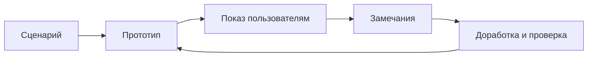
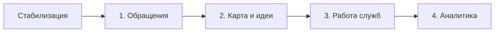

# Практическая работа № 4

**Дисциплина:** Технологии разработки программного обеспечения  
**Тема:** RAD, инкрементная и эволюционная модели  
**Объект исследования:** Smart Qala (VoiceOfSemey)  
**Дата:** 8 октября 2026 года

## Тема

Планирование быстрого прототипирования, инкрементных версий и эволюционного уточнения Smart Qala.

## Цель

Изучить RAD, инкрементную и эволюционную модели; разделить функциональность Smart Qala на четыре возможные версии и обосновать применимость моделей к проекту.

## Теоретические сведения

**RAD (Rapid Application Development)** — подход к быстрой разработке приложений с короткими ограниченными по времени циклами, прототипами интерфейса и активной обратной связью пользователей. Он уместен, когда предметную область можно показать на прототипе и участники готовы оперативно принимать решения. Скорость демонстрации интерфейса не заменяет проверку безопасности, сохранности данных и готовности к эксплуатации.

**Инкрементная модель** добавляет к предыдущей версии законченную проверенную часть функций по заранее определённому плану. **Эволюционная модель** уточняет требования и решение после наблюдения за прототипом; содержание следующей версии может измениться по результатам отзывов. Прототипирование — способ изучить сценарий до окончательного решения о нём. Эти приёмы могут сочетаться в одном проекте, но ниже они разделены для анализа.

## Задание

Выделить функции Smart Qala, распределить их по 3–4 версиям, описать RAD, инкрементный и эволюционный варианты работы и определить ограничения. Методичка предлагает учебное мобильное приложение университета; по общему заданию серии работ объект заменён на фактический проект Smart Qala. Регистрация и оценки из учебного примера не приписываются этому проекту.

## Ход выполнения

### 1. Функции и границы существующего прототипа

В коде имеются форма `/create`, анализ текста `/api/ai`, список и карточка `CityRequest`, карта `/map`, идеи `/ideas`, панель `/admin`, аналитика `/analytics`, уведомления и демонстрационный вход. Роли `citizen`, `employee`, `admin` заданы в типах; гостевой режим задаётся флагом, а не отдельной ролью. Пользовательские режимы управляются клиентским состоянием. Данные находятся в памяти процесса; постоянного хранилища и серверной авторизации нет.

**Таблица 1 — Исходный материал для планирования версий.**

| Функция | Что уже есть в коде | Что потребуется проверить или добавить |
|---|---|---|
| Обращение и идея | `/create`, POST `/api/requests`, `CityRequest` | Согласованность типов, ввод и сквозной сценарий |
| Анализ текста | `/api/ai`, Gemini либо локальные правила | Качество ответа и отказоустойчивость |
| Карта, идеи, голоса | `/map`, `/ideas`, API голосования | Приватность ответа и серверный контроль повторных голосов |
| Обработка заявок | `/admin`, PATCH заявки, официальные сообщения | Серверные роли, правила статусов, постоянное хранение |
| Аналитика и уведомления | `/analytics`, `/api/notifications` | Достоверные показатели и сохранность событий |

На 08.10.2026 текущая рабочая копия не проходит TypeScript-проверку из-за `AppContext.tsx`; ESLint сообщает 9 ошибок. Поэтому перечисление функций означает наличие кода, а не подтверждение готового выпуска. Все версии ниже — **план будущих проверок и доработок**, не история релизов.

### 2. RAD-вариант

Для ограниченной задачи «житель описывает проблему и видит карточку обращения» можно провести короткий цикл: согласовать сценарий с представителями жителей и сотрудников; показать форму и карточку; зафиксировать замечания; изменить прототип; повторно проверить сценарий. Следующий цикл можно посвятить отображению статуса и служебному ответу. Размер цикла задаётся конкретным проверяемым результатом, а не обещанием выпустить систему за произвольное число дней.

**Рисунок 1 — Цикл RAD для интерфейса обращения Smart Qala.**

Этот цикл подходит для уточнения понятности формы, карточки и текста статусов. Он не подтверждает, что реальные жители или сотрудники уже участвовали в тестировании. До внешнего показа с настоящими данными нужно устранить ошибки типов и защитить поля автора. Серверные полномочия и сохранность записей требуют отдельных проверок независимо от скорости прототипирования.

### 3. Инкрементный план из четырёх версий

Общий подготовительный шаг: согласовать `AppContext.tsx` с используемыми компонентами, добиться успешной проверки типов, устранить блокирующие ошибки линтера и определить критерии приёмки. Порядок версий сохраняет логику практической № 2: обращение → публичное взаимодействие → работа служб → аналитика и сопровождение.

**Таблица 2 — Проектный план четырёх версий Smart Qala.**

| Версия | Содержание | Проверяемый результат и ограничение |
|---|---|---|
| 1. Обращения | `/create`, `/api/ai`, POST заявки, карточка | Внутренний сценарий «текст — запись — карточка»; выпуск с персональными данными не заявляется |
| 2. Публичное взаимодействие | `/map`, `/ideas`, голосование | Просмотр без полей автора; серверная защита голосования нужна для реального использования |
| 3. Контур служб | `/admin`, статусы, модерация, ответ | Нужны серверная аутентификация, разрешённые переходы и постоянное хранилище |
| 4. Аналитика и сопровождение | `/analytics`, уведомления, наблюдение | Реальный расчёт показателей, проверка сохранности и резервного восстановления |

**Рисунок 2 — Последовательность планируемых версий Smart Qala.**

После каждой версии проверяются новые функции и уже подготовленные сценарии. Первая проверенная версия может быть внутренней демонстрацией. Решение о публичном выпуске возможно только после подтверждения защиты данных и других критериев соответствующего контура. Внешняя интеграция со службой 109 в коде отсутствует и в эти четыре версии не включена.

### 4. Эволюционный вариант

В отличие от фиксированной последовательности инкрементов, здесь следующая работа определяется результатом наблюдения за предыдущим прототипом. Например, если во время будущей проверки пользователи не понимают статус `under_review`, уточняются текст и карточка; если проверка выявляет раскрытие `author_phone` через публичный GET API, приоритетом становятся состав ответа и контроль доступа. Это условные примеры возможных решений, а не сведения о уже полученных отзывах.

**Рисунок 3 — Эволюционное уточнение Smart Qala по результатам проверки.**

При таком подходе состав следующей версии может измениться. Но обязательные условия реального выпуска — защита персональных данных, разграничение полномочий и сохранность обращений — нельзя откладывать только потому, что их не упомянули участники демонстрации.

### 5. Сопоставление и выбор

**Таблица 3 — Применимость трёх моделей к Smart Qala.**

| Критерий | RAD | Инкрементная | Эволюционная |
|---|---|---|---|
| Основной результат | Быстро проверенный прототип сценария | Плановая законченная часть | Версия с уточнёнными требованиями |
| Порядок функций | Определяется короткими циклами | Задан планом версий | Пересматривается после отзывов |
| Участие пользователей | Частое во время цикла | При приёмке версий | Необходимо после прототипа |
| Ограничение | Нужны доступные участники и чёткая граница цикла | Риск жёсткого плана при новых данных | Сложнее заранее оценить полный объём |

Для Smart Qala разумно использовать **инкрементный план из четырёх версий** и RAD-приёмы для проверки интерфейса внутри каждой версии. Обратная связь может менять приоритеты следующего инкремента, но не отменяет обязательные требования к безопасности. Это проектная рекомендация; фактический процесс команды по текущему коду не установлен.

## Результаты

Выделены пять групп функций исходного прототипа, построен план из четырёх версий и два цикла уточнения — RAD и эволюционный. Для каждой версии указано, что можно проверить по существующему коду и что ещё требуется для реального выпуска. Разработки новых функций и выпуска версий в рамках этой практической не было.

## Вывод

RAD помогает быстро проверить понятность отдельных пользовательских сценариев, инкрементная модель организует последовательное развитие модулей, а эволюционная модель позволяет пересматривать требования после испытания прототипа. Для Smart Qala главным ограничением остаётся неподтверждённая сборка текущей рабочей копии, отсутствие серверного контроля доступа и постоянного хранения. Поэтому план версий начинается со стабилизации и допускает внутренние проверки до публичного выпуска.

## Ответы на контрольные вопросы

**1. Что означает RAD?** Rapid Application Development — быстрая разработка приложений с короткими циклами, прототипами и частой обратной связью участников.

**2. Какова роль прототипирования?** Оно позволяет проверить сценарий и интерфейс до окончательного закрепления решения, выявить непонятные места и уточнить требования.

**3. Что такое инкремент?** Законченная проверенная часть функций, которая расширяет предыдущую версию. В плане Smart Qala пример — отдельно проверенный сценарий создания обращения.

**4. Чем инкрементная модель отличается от эволюционной?** В инкрементной модели состав очередных частей преимущественно задан планом; в эволюционной он определяется после проверки прототипа и может существенно измениться.

**5. Каковы ограничения RAD?** Нужны доступные для регулярной обратной связи пользователи и небольшие управляемые циклы; быстрый прототип не заменяет системные проверки, защиту данных, надёжное хранение и подготовку к эксплуатации.

## Использованные материалы

1. «Практические работы ТРПО.docx», практическое занятие № 4: тема, цель, версии, дополнительное задание и контрольные вопросы.
2. `SMART_QALA_PROJECT_INFO.md` — проверенное состояние проекта на 08.10.2026.
3. `practice-02.md` и `practice-03.md` — общий предметный сценарий и согласованный порядок версий.
4. Исходный код: `src/types/index.ts`, `src/app`, `src/lib/mock-data.ts`, `src/context/AppContext.tsx`, `package.json`.
