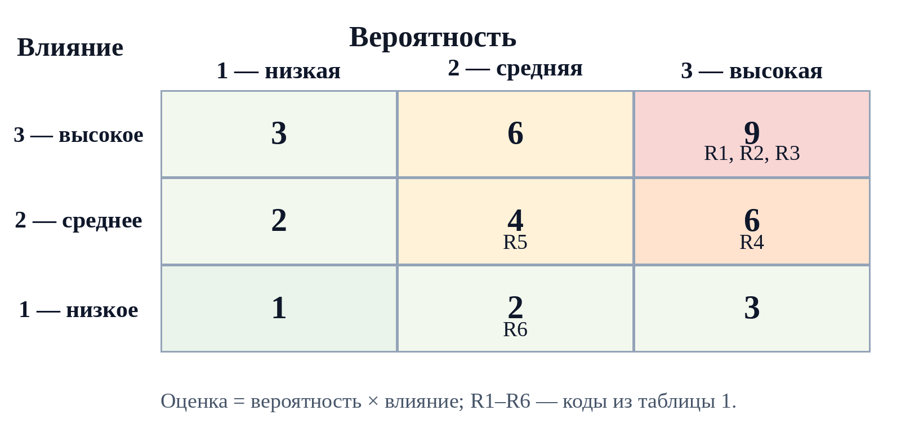
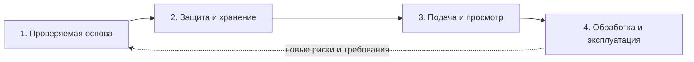

# Практическая работа № 5

**Дисциплина:** Технологии разработки программного обеспечения  
**Тема:** Спиральная модель и управление рисками  
**Объект исследования:** Smart Qala (VoiceOfSemey)  
**Дата:** 13 октября 2026 года

## Тема

Спиральная модель жизненного цикла и оценка рисков развития Smart Qala.

## Цель

Научиться выделять риски программного проекта, задавать для каждого витка спирали цель, варианты решения, меры снижения риска и проверяемый результат.

## Теоретические сведения

Спиральная модель организует разработку повторяющимися витками. В начале витка уточняют цель и ограничения, затем сравнивают варианты решения, анализируют риски, выполняют необходимую разработку или прототипирование и оценивают результат перед следующим витком. Решение о продолжении опирается на снижение наиболее существенной неопределённости. Спираль не требует выпускать продукт пользователям после каждого витка: промежуточным результатом может быть проверенный прототип или проектное решение.

**Риск проекта** — неопределённое событие либо условие, способное помешать цели. Для учебной приоритизации ниже вероятность наступления при неизменном состоянии проекта и влияние оцениваются по шкале 1–3: 1 — низкое, 2 — среднее, 3 — высокое. Произведение `P × I` служит порядковым приоритетом для обсуждения. Это экспертная оценка сценария будущего выпуска, а не измеренная статистическая вероятность.

**Прототипирование** уменьшает риск ошибочного решения, когда позволяет проверить конкретную гипотезу: например, понятность формы обращения или совместимость компонентов с API. Прототип не доказывает безопасность, сохранность данных и эксплуатационную готовность без соответствующих проверок.

## Задание

Построить спиральную модель для Smart Qala. Для каждого витка определить цель, варианты решения, риски, меры снижения и ожидаемый результат. Составить таблицу рисков. В методичке приведена медицинская система; согласно общей теме практических работ здесь рассмотрен реальный исходный код Smart Qala.

## Ход выполнения

### 1. Фактическая отправная точка

В Smart Qala представлены `CityRequest`, `UserProfile`, форма `/create`, анализ текста `/api/ai`, список и карточка обращений, карта, идеи, панель `/admin` и аналитика. Демонстрационные записи находятся в памяти серверного процесса через `mock-data.ts`; постоянной базы данных нет. Роль пользователя и вход хранятся на клиенте, API не проверяют полномочия. Публичные GET-обработчики возвращают объект обращения целиком, включая необязательные поля автора.

Проверка текущей рабочей копии 13.10.2026: `tsc --noEmit` завершилась ошибками из-за несогласованности `AppContext.tsx` с компонентами; ESLint с флагом `--quiet` сообщил 9 ошибок. Эти факты задают исходные риски. Витки ниже являются **планом возможного развития**; команда не заявляла о выполнении этих этапов.

### 2. Шкала и реестр рисков

Приоритет 7–9 рассматривается первым, 4–6 — следующим, 1–3 — контролируется. Числа помогают упорядочить работу, но не заменяют анализ причин и проверку мер. Для уже наблюдаемого дефекта вероятность сохранения проблемы без исправления оценена как высокая; для будущих внешних сбоев оценка условна.

**Таблица 1 — Реестр проектных рисков Smart Qala на 13.10.2026.**

| Риск и основание | Оценка P × I | Возможное влияние | Мера снижения и проверка |
|---|---|---|---|
| R1. Публичный API выдаёт поля автора | 3 × 3 = 9 | Раскрытие персональных данных | Разделить публичный и служебный ответ; проверить состав GET API |
| R2. API не проверяет роль при изменении заявки | 3 × 3 = 9 | Несанкционированное изменение данных | Серверная аутентификация и авторизация; тесты запрета PATCH |
| R3. Записи хранятся в памяти процесса | 3 × 3 = 9 | Потеря обращений при перезапуске | Постоянное хранилище, миграции, резервное копирование; тест восстановления |
| R4. Текущая рабочая копия не проходит TypeScript | 3 × 2 = 6 | Нельзя подтвердить сборку и сценарии | Согласовать `AppContext.tsx` и компоненты; повторить `tsc`, lint и проверку сценариев |
| R5. Автоматическая классификация может ошибиться | 2 × 2 = 4 | Неверная категория, приоритет или ведомство | Проверить набор примеров; дать сотруднику возможность исправления |
| R6. Тайлы карты зависят от внешнего сервиса | 2 × 1 = 2 | Карта может не загрузиться | Проверить состояние ошибки и доступность списка обращений без карты |

Оценки R1–R4 основаны на подтверждённых свойствах текущего кода, а баллы описывают риск для **будущего использования с реальными данными**. Баллы R5–R6 являются предположением для планирования; частота ошибок ИИ или сбоев тайлов в этом проекте не измерялась.

**Рисунок 1 — Матрица приоритетов рисков Smart Qala.**

### 3. Проектные витки спирали

Приоритеты R1–R3 исключают публичный выпуск с реальными персональными данными до завершения соответствующих проверок. Витки определены по уменьшаемому риску, а не как уже состоявшиеся релизы. Исходный сценарий и обозначения сохраняются из практических № 1–4: житель создаёт `CityRequest`, сотрудник обрабатывает заявку, администратор модерирует.

**Таблица 2 — Цели, варианты, риски и ожидаемые результаты витков.**

| Виток и цель | Варианты решения | Главный риск и снижение | Ожидаемый результат |
|---|---|---|---|
| 1. Восстановить проверяемую основу | Согласовать контекст с компонентами точечными правками; либо переработать интерфейс контекста целиком | R4: выбрать минимальное согласование, повторить `tsc`, lint и внутренний сценарий создания записи | Проверяемая рабочая копия и список оставшихся дефектов |
| 2. Защитить и сохранить обращения | Публичная проекция `CityRequest` плюс серверные роли; долговременное хранилище с миграцией сид-данных | R1–R3: тестировать GET без полей автора, отказ PATCH без роли, сохранение после перезапуска | Кандидат на безопасный контур данных; открытый выпуск только после приёмки |
| 3. Проверить подачу и общественный просмотр | Прототипировать форму, карточку, карту и идеи; сравнить сценарии с отзывами пользователей | R5–R6: примеры классификации, обработка отказа ИИ и карты; контроль голосования на сервере | Проверенные сценарии обращения и просмотра без раскрытия данных |
| 4. Проверить обработку и эксплуатацию | Уточнить статусы, модерацию, ответы, аналитику и наблюдение | Ошибки полномочий, недостоверные показатели и потеря событий; интеграционные и приёмочные проверки | Кандидат на служебный процесс и план сопровождения |

Для второго витка «публичная проекция» означает проектное предложение: сейчас GET `/api/requests` и GET `/api/requests/[id]` возвращают объект целиком. Для третьего витка участие пользователей также планируется, но не утверждается как уже полученная обратная связь. В четвёртом витке показатель `avg_resolution_days` должен вычисляться из фактов: сейчас в `getRequestStats()` он задан константой `1.8`.

**Рисунок 2 — Последовательность риск-ориентированных витков Smart Qala.**

Каждый виток проходит четыре решения: сформулировать цель, сравнить варианты, проверить главный риск, принять или изменить план следующего витка. Если критерии по R1–R3 не выполнены, работа возвращается к соответствующему решению, а публичное использование остаётся отложенным.

## Результаты

Составлен реестр из шести рисков с прозрачной порядковой оценкой, построена матрица приоритетов и предложены четыре витка спирали. Для каждого витка указаны варианты решения, способ проверки риска и ожидаемый результат. Выявленные в коде ограничения отделены от проектных мер, которые ещё не реализованы.

## Вывод

Спиральная модель полезна Smart Qala там, где прежде следующей функции нужно уменьшить риск: защита персональных данных, полномочия и сохранность записей важнее скорости публичного выпуска. Первыми действиями должны стать восстановление проверяемой рабочей копии и проектирование безопасного контура данных. Это не отменяет инкрементный план практических № 2 и № 4: анализ риска может служить условием перехода к следующей версии.

## Ответы на контрольные вопросы

**1. Что является главным элементом спиральной модели?** Повторяющийся виток с анализом и снижением риска перед решением о следующей работе.

**2. Что такое риск проекта?** Неопределённое событие или условие, которое может ухудшить сроки, качество, безопасность либо достижение цели проекта.

**3. Как оценивается влияние риска?** Определяют последствия для цели и пользователей, затем задают шкалу влияния. В этой работе 1 означает низкое, 2 — среднее, 3 — высокое влияние; приоритет для обсуждения равен `P × I` и не является точной вероятностью ущерба.

**4. Почему спиральная модель подходит для крупных проектов?** Она позволяет поэтапно исследовать архитектурные, интеграционные и организационные неопределённости до крупного вложения в окончательное решение. При этом дополнительные циклы анализа имеют стоимость и должны быть оправданы уровнем риска.

**5. Как прототипирование помогает снизить риски?** Проверка прототипа даёт ранние данные о понятности сценария или технической совместимости. Для Smart Qala прототип формы помогает выявить ошибки ввода, но не заменяет тесты серверного доступа и постоянного хранения.

## Использованные материалы

1. «Практические работы ТРПО.docx», занятие № 5.
2. `SMART_QALA_PROJECT_INFO.md`; `practice-01.md`–`practice-04.md`.
3. Код: `src/types/index.ts`, `src/lib/mock-data.ts`, `src/lib/ai-service.ts`, `src/context/AppContext.tsx`, `src/app/api`, `src/components/CityMap.tsx`.
4. Проверка 13.10.2026: `tsc --noEmit`; `npm run lint -- --quiet`.
