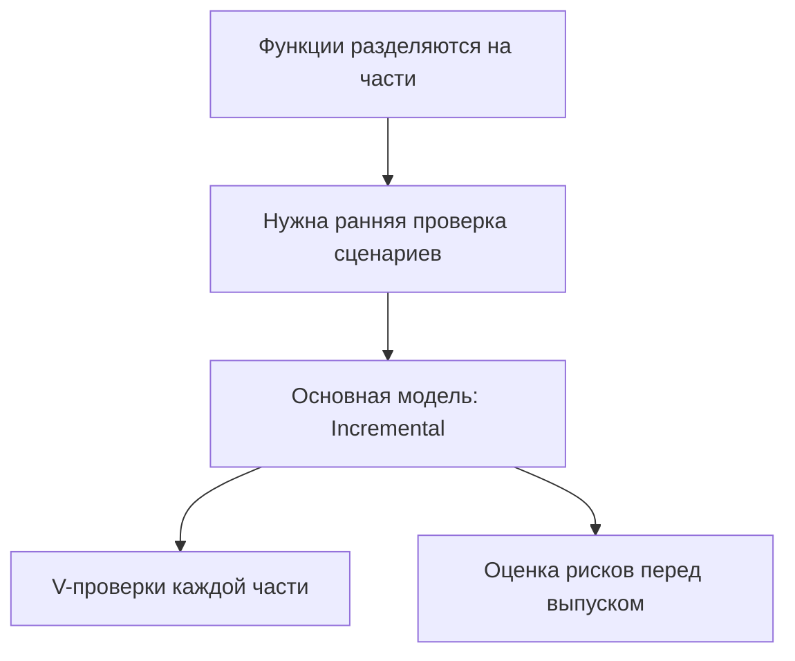
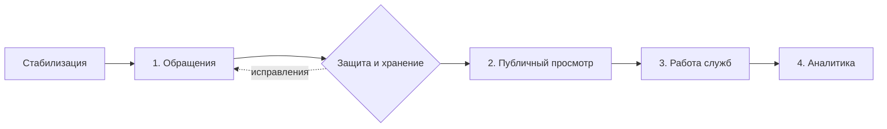

# Практическая работа № 6

**Дисциплина:** Технологии разработки программного обеспечения  
**Тема:** Выбор модели жизненного цикла  
**Объект исследования:** Smart Qala (VoiceOfSemey)  
**Дата:** 13 октября 2026 года

## Тема

Выбор модели разработки с учётом характеристик Smart Qala и сравнение с учебными проектами методических указаний.

## Цель

Научиться сопоставлять свойства проекта с каскадной, V-образной, RAD, инкрементной, эволюционной и спиральной моделями и аргументированно выбирать основной способ организации работ.

## Теоретические сведения

Модель жизненного цикла определяет порядок работ, частоту проверок и способ реагирования на новые требования. **Waterfall** удобна при стабильных заранее согласованных требованиях. **V-model** связывает требования и проектные уровни с планируемыми проверками. **RAD** ускоряет проверку ограниченного сценария через прототипы и частую обратную связь. **Incremental** добавляет законченные функциональные части. **Evolutionary** меняет решение на основе изучения предыдущей версии. **Spiral** ставит анализ существенного риска перед выбором следующего шага.

Выбор модели зависит от изменчивости требований, возможности разделить систему на части, цены ошибки, потребности в ранней обратной связи и ограничений текущей реализации. Отдельные приёмы разных моделей допустимы в одном процессе, но для организации работы полезно назвать **основную** модель и критерии перехода между этапами.

## Задание

Для десяти типов проектов из методических указаний выбрать по одной подходящей модели и кратко обосновать выбор. Затем применить тот же принцип к реальному Smart Qala, сохранив предметную область и выводы практических № 1–5. Указанные в методичке проекты используются только как сравнительные учебные случаи; их функции не объявляются частью Smart Qala.

## Ход выполнения

### 1. Критерии выбора для Smart Qala

Smart Qala содержит форму `/create`, API обращений и анализа текста, карту `/map`, идеи `/ideas`, панель `/admin` и аналитику `/analytics`. Основная сущность — `CityRequest`; роли интерфейса — `citizen`, `employee`, `admin`, с демонстрационным гостевым режимом. Функции можно группировать по пользовательским сценариям, как сделано в практических № 2 и № 4.

**Таблица 1 — Характеристики Smart Qala, влияющие на выбор модели.**

| Критерий | Подтверждённое состояние | Следствие для организации работ |
|---|---|---|
| Разделимость функций | Форма, карта, идеи, панель и аналитика представлены разными маршрутами и модулями | Возможны последовательные проверяемые части |
| Требования и обратная связь | Формальной согласованной спецификации и подтверждённых пользовательских испытаний нет | Нужна проверка сценариев после каждой части |
| Цена ошибки доступа | API не проверяет роль; публичный GET возвращает объект с необязательными полями автора | Защита данных должна быть условием публичного выпуска |
| Сохранность данных | `mock-data.ts` хранит записи в памяти процесса | Реальное использование требует постоянного хранилища и восстановления |
| Техническая проверяемость | На 13.10.2026 `tsc --noEmit` не проходит; ESLint сообщает 9 ошибок | Начать со стабилизации и повторных проверок |

Таблица отражает текущую рабочую копию. Наличие файлов не доказывает, что все сценарии сейчас выполняются. Модель выбирается для **дальнейшего развития**, а не реконструируется как уже применённый командой процесс.

### 2. Сопоставление шести моделей

**Таблица 2 — Пригодность моделей для следующего этапа Smart Qala.**

| Модель | Пригодность | Основание |
|---|---|---|
| Waterfall | Низкая как основная | Все требования и способы интеграции ещё не согласованы; проверка целого результата была бы поздней |
| V-model | Высокая для проверок | Требования к доступу, сохранности и статусам можно связать с приёмочными и техническими проверками |
| RAD | Средняя для интерфейса | Форма и карточка подходят для прототипирования, но быстрый показ не подтверждает защиту и хранение |
| Incremental | Высокая как основная | Модули позволяют проверять обращения, публичный просмотр, работу служб и аналитику по очереди |
| Evolutionary | Средняя для уточнения | Отзывы полезны для формы и статусов; обязательные условия безопасности нельзя оставить открытыми |
| Spiral | Высокая для рискованных решений | Риски доступа, приватности и хранения требуют отдельной оценки перед реальным выпуском |

**Выбор:** основная модель — **инкрементная**. Внутри каждого инкремента применяются соответствующие уровни проверки V-модели, а риски из практической № 5 служат условиями решения о следующем шаге. Это проектное предложение. Термин «высокая пригодность» не означает, что соответствующий процесс уже организован в команде.

### 3. Проверка выбора на десяти учебных проектах

Методичка требует выбрать модель для каждого из десяти вариантов. Ниже даны условные решения при типичных характеристиках, указанных в обосновании. Для реального проекта потребовались бы его собственные требования и ограничения; таблица не заменяет такой анализ.

**Таблица 3 — Выбор основной модели для вариантов из методических указаний.**

| Учебный проект | Выбранная модель | Обоснование при указанном допущении |
|---|---|---|
| 1. Управление атомной электростанцией | V-model | При заранее строго заданных требованиях важна прослеживаемость каждой функции до проверки безопасности |
| 2. Интернет-магазин | Incremental | Каталог, корзину, оплату и поддержку можно выпускать и проверять частями |
| 3. Экспериментальная система ИИ | Evolutionary | Качество решения и требования уточняются по результатам экспериментов |
| 4. Банковская система | Spiral | При сложной интеграции и высокой цене отказа сначала проверяют главные технические и организационные риски |
| 5. Мобильная игра | RAD | Ограниченный игровой сценарий можно быстро прототипировать и проверять с игроками |
| 6. Система университета | Incremental | Расписание, оценки и кабинеты можно вводить отдельными проверяемыми частями |
| 7. Управление медицинским оборудованием | V-model | Требуется связать спецификации и проверки поведения оборудования на каждом уровне |
| 8. Социальная сеть | Evolutionary | Пользовательские сценарии и приоритеты меняются после обратной связи |
| 9. Автоматизированный склад | Waterfall | Подходит, если процессы и интеграционные требования заранее стабильны и утверждены |
| 10. Доставка еды | Incremental | Заказ, отслеживание и работа исполнителя допускают последовательную реализацию |

Названия учебных систем сами по себе не определяют модель. Например, для склада с неизвестным оборудованием и высокими интеграционными рисками вместо каскада могла бы потребоваться спиральная модель. Выбор в таблице верен только при записанном допущении.

### 4. План применения выбранной модели к Smart Qala

Перед первым инкрементом необходимо согласовать `AppContext.tsx` с компонентами и повторить проверку типов и линтера. Далее сохраняется последовательность практических № 2 и № 4: **1 — обращения; 2 — карта, идеи и голосование; 3 — работа служб; 4 — аналитика и сопровождение**. Каждая часть проверяется вместе с ранее подготовленными функциями. Внутренняя демонстрация допустима раньше публичного выпуска; работа с реальными персональными данными требует подтверждённой защиты и сохранности.

**Рисунок 1 — Логика выбора основной модели для Smart Qala.**

**Рисунок 2 — Переходы между инкрементами с проверкой риска.**

На рисунке 2 проверка доступа и хранения стоит перед публичным просмотром как обязательное условие решения о выпуске, а не как уже работающий механизм. Конкретные тесты и критерии приёмки должны быть согласованы до начала соответствующего инкремента; в текущем `package.json` отдельного `test`-скрипта нет.

## Результаты

Для десяти учебных типов проектов выбрана основная модель с оговорёнными допущениями. Для Smart Qala по пяти критериям сопоставлены шесть моделей и выбрана инкрементная организация дальнейшей работы. Предложены условия технической и риск-ориентированной проверки между частями. Никакой новый выпуск или изменение кода в рамках работы не выполнялись.

## Вывод

Инкрементная модель лучше всего соответствует модульной структуре Smart Qala и позволяет проверять сценарии по частям. Приёмы V-модели дают прослеживаемость требований и тестов, а анализ рисков предотвращает переход к публичному использованию до проверки доступа, приватности и сохранности данных. Рекомендация согласуется с практическими № 2–5 и не выдаёт проектный план за существующий процесс команды.

## Ответы на контрольные вопросы

В методических указаниях для занятия № 6 отдельный список контрольных вопросов не приведён. Ниже приведены вопросы по теме работы, чтобы сохранить единый формат отчётов.

**1. Какие характеристики проекта важны при выборе модели?** Стабильность требований, цена ошибки, разделимость функций, обратная связь и условия приёмки.

**2. Почему для Smart Qala выбрана инкрементная модель?** Обращения, публичный просмотр, работа служб и аналитика образуют отдельные проверяемые части.

**3. Когда V-модель полезна внутри инкремента?** Когда требование нужно связать с проверкой; например, отсутствие полей автора проверяют в ответе API и полном сценарии.

**4. Почему RAD не выбрана основной моделью?** Быстрый прототип формы не решает вопросы серверного доступа, хранения и проверки выпуска.

**5. Может ли выбор модели измениться?** Да. Если интеграционные риски окажутся выше ожидаемых, основной может стать спиральная модель; проверки безопасности сохраняются.

## Использованные материалы

1. «Практические работы ТРПО.docx», занятие № 6.
2. `SMART_QALA_PROJECT_INFO.md`; `practice-01.md`–`practice-05.md`.
3. Код: `src/types/index.ts`, `src/app`, `src/lib/mock-data.ts`, `src/context/AppContext.tsx`, `package.json`.
4. Проверка 13.10.2026: `tsc --noEmit`; `npm run lint -- --quiet`.
