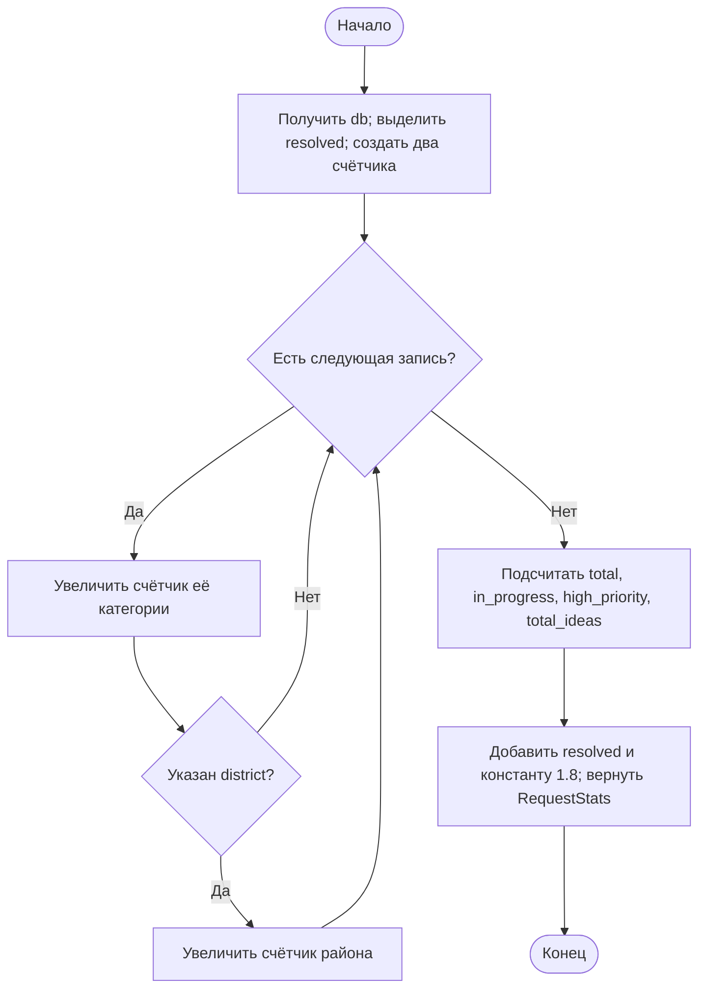

# Практическая работа № 7

**Дисциплина:** Технологии разработки программного обеспечения  
**Тема:** Структурное программирование  
**Объект исследования:** Smart Qala (VoiceOfSemey)  
**Дата:** 29 октября 2026 года

## Тема

Структурное представление и проверка алгоритма вычисления статистики городских обращений Smart Qala.

## Цель

Показать последовательность, ветвление и цикл на существующем алгоритме проекта; построить блок-схему и проверить результат на демонстрационных данных без изменения исходного кода.

## Теоретические сведения

Структурное программирование строит алгоритм из трёх базовых конструкций: **последовательность** задаёт порядок операций, **ветвление** выбирает действие по условию, **цикл** повторяет действие для набора элементов. Блок-схема помогает проверить порядок вычислений и условия выхода. Тестирование сопоставляет ожидаемые и фактические результаты; оно должно охватывать основные ветви и агрегаты.

В TypeScript перебор массива может быть выражен методом `forEach`, а выбор элементов — методом `filter`. Это формы циклической обработки коллекции, хотя в коде нет ключевого слова `for`. В отчёте сохраняется различие между фактической реализацией и её графическим представлением.

## Задание

В методичке предлагается выбрать задачу, составить алгоритм и блок-схему, показать три базовые конструкции, реализовать алгоритм на языке программирования и выполнить тестирование. Для единой предметной области выбрана уже реализованная функция `getRequestStats()` из `src/lib/mock-data.ts`. Она вычисляет сводку по массиву `CityRequest`. Реализация на TypeScript уже существует; в рамках этой работы она изучена и проверена, а не написана повторно.

## Ход выполнения

### 1. Выбор алгоритма и его интерфейс

`getRequestStats()` получает демонстрационный реестр через внутреннюю `getDatabase()` и возвращает объект `RequestStats`. Прямого параметра-массива у функции нет. Данные находятся в памяти серверного процесса; результат не является статистикой реальных городских обращений.

**Таблица 1 — Вход, обработка и выход существующей функции.**

| Элемент | Фактическое содержание |
|---|---|
| Вход | Массив `CityRequest` из `getDatabase()`; записи имеют `status`, `priority`, `type`, `category` и необязательный `district` |
| Выход | `total`, `in_progress`, `high_priority`, `resolved`, `total_ideas`, `by_category`, `by_district`, `avg_resolution_days` |
| Особенность | `in_progress` считает два статуса: `in_progress` и `assigned`; `avg_resolution_days` возвращает константу `1.8`, а не рассчитанное среднее |

### 2. Разбор структурных конструкций

Сначала функция получает реестр и выделяет записи со статусом `resolved`. Затем создаёт два пустых счётчика по категориям и районам. `forEach` проходит по каждой записи: число для категории увеличивается всегда, число для района — только при наличии `district`. После этого отдельные `filter` подсчитывают записи в работе, с высоким приоритетом и типа `idea`; возвращается объект результата. Сначала представлена блок-схема, затем псевдокод, отражающий существующий TypeScript-код.

**Рисунок 1 — Блок-схема алгоритма `getRequestStats()`.**




```text
db ← getDatabase()
resolved ← filter(db, status = resolved)
byCategory ← {}; byDistrict ← {}
для каждой request из db:
    byCategory[request.category] ← текущее значение или 0, затем +1
    если request.district существует:
        byDistrict[request.district] ← текущее значение или 0, затем +1
вернуть {
    total: длина db,
    in_progress: число status = in_progress или assigned,
    high_priority: число priority = high,
    resolved: длина resolved,
    total_ideas: число type = idea,
    avg_resolution_days: 1.8,
    by_category: byCategory,
    by_district: byDistrict
}
```


На схеме цикл `forEach` показан как возврат к проверке следующей записи. Остальные выборки `filter` тоже перебирают массив, но для читаемости объединены в одном блоке подсчёта.

### 3. Проверка на работающем API

29.10.2026 запрошен `GET /api/requests`. Независимый подсчёт по возвращённому массиву сопоставлен с объектом `stats` из того же ответа. Дополнительно проверен запрос `GET /api/requests?category=Дороги`: фильтр сокращает список до трёх записей, но `stats` остаётся сводкой всего реестра из 17 записей. Это соответствует коду обработчика: `getRequestStats()` вызывается отдельно после фильтрации списка.

**Таблица 2 — Результаты проверки на демонстрационном реестре.**

| Проверка | Ожидается по независимому подсчёту | Получено | Итог |
|---|---:|---:|---|
| Всего записей | 17 | 17 | Совпадает |
| `in_progress` или `assigned` | 6 | 6 | Совпадает |
| Высокий приоритет | 9 | 9 | Совпадает |
| Статус `resolved` | 4 | 4 | Совпадает |
| Тип `idea` | 4 | 4 | Совпадает |
| Сумма `by_category` | 17 | 17 | Совпадает |
| Сумма `by_district` | 17 | 17 | Совпадает для данного набора |
| Фильтр «Дороги» / общая статистика | 3 / 17 | 3 / 17 | Совпадает |

Набор из 17 записей покрывает несколько категорий, районов, статусов и приоритетов. В нём у каждой записи заполнен район, поэтому ветвь без `district` проверена по коду, но не отдельным выполненным тестом. Пустой реестр также не проверялся. Константа `1.8` подтверждена исходным кодом и ответом API; её нельзя трактовать как вычисленное среднее время решения.

## Результаты

Для реальной функции TypeScript составлены входно-выходная модель, псевдокод и блок-схема. Независимый подсчёт восьми характеристик и проверка фильтра совпали с ответом API. Исходный код не изменялся; постоянное хранилище и автоматические unit-тесты не добавлялись.

## Вывод

Алгоритм `getRequestStats()` демонстрирует последовательность, ветвление и циклический проход по реестру обращений. На текущем демонстрационном наборе вычисляемые показатели совпадают с независимой проверкой. Константа среднего срока и отсутствие проверки пустого набора ограничивают интерпретацию результата; для производственного применения нужны отдельные тесты и расчёт срока по датам.

## Ответы на контрольные вопросы

В методичке для занятия № 7 отдельные контрольные вопросы не приведены. Ниже даны вопросы по теме работы.

**1. Где в алгоритме последовательность?** Получение реестра, создание счётчиков, перебор и формирование `RequestStats` выполняются в заданном порядке.

**2. Где ветвление?** Поле `district` проверяется перед увеличением районного счётчика; фильтры также выбирают записи по условиям статуса, типа и приоритета.

**3. Где цикл?** `forEach` обходит каждую запись для распределения по категориям и районам; `filter` также выполняет перебор массива.

**4. Почему `assigned` включён в показатель работы?** Условие в `getRequestStats()` явно считает оба статуса: `assigned` и `in_progress`.

**5. Доказано ли значение среднего срока 1,8 дня?** Нет. Число `1.8` задано в коде как константа и не вычисляется из `created_at` и `resolved_at`.

## Использованные материалы

1. «Практические работы ТРПО.docx», практическое занятие № 7.
2. `src/lib/mock-data.ts`: `getDatabase()`, `getRequestStats()`; `src/types/index.ts`: `CityRequest`, `RequestStats`.
3. `src/app/api/requests/route.ts`; ответ локального API от 29.10.2026.
4. `SMART_QALA_PROJECT_INFO.md`; практические работы № 1–6 для согласования терминов.
