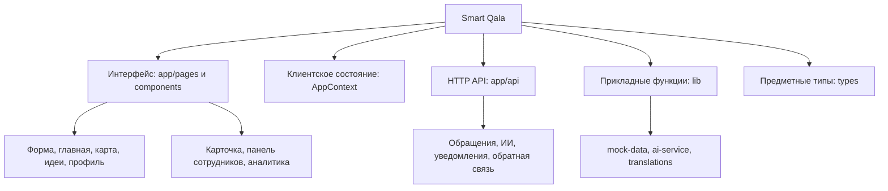
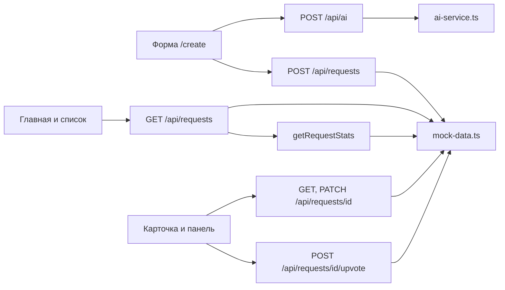

# Практическая работа № 8

**Дисциплина:** Технологии разработки программного обеспечения  
**Тема:** Модульное и нисходящее проектирование  
**Объект исследования:** Smart Qala (VoiceOfSemey)  
**Дата:** 29 октября 2026 года

## Тема

Нисходящая декомпозиция существующего приложения Smart Qala и модуля обработки городских обращений.

## Цель

Научиться выделять модули по назначению, строить дерево модулей, описывать их интерфейсы и составлять псевдокод одного действующего модуля.

## Теоретические сведения

Модуль объединяет связанные операции и предоставляет другим частям системы понятный интерфейс. При **нисходящем проектировании** сначала определяют задачу системы, затем крупные подсистемы и только после этого отдельные операции. **Вход** модуля — данные или вызов, которые он принимает; **выход** — возвращаемое значение, изменение состояния либо отображаемый результат. Дерево показывает функциональное разбиение, а стрелки зависимостей — фактические вызовы; эти представления не следует смешивать.

Для Smart Qala важно отделять клиентское состояние `AppContext` от серверных Route Handlers и от `mock-data.ts`. Демонстрационный вход с ролями `citizen`, `employee`, `admin` и флагом гостя не является серверной авторизацией. Массивы в `mock-data.ts` не являются базой данных с постоянным хранением.

## Задание

Методичка предлагает дерево модулей университетской информационной системы, описание каждого модуля, его входов и выходов и псевдокод одного модуля. По требованию единой предметной области вместо учебного примера рассмотрен реальный Smart Qala. Второй уровень подробно раскрывает подсистему обращений `CityRequest`.

## Ход выполнения

### 1. Верхний уровень системы

В исходниках есть маршруты Next.js, компоненты интерфейса, клиентский контекст, HTTP-обработчики, функции `lib` и определения типов. Следующая схема — аналитическое дерево по ответственности. Узлы «интерфейс» и «данные» не означают отдельные развёрнутые сервисы.

**Рисунок 1 — Дерево модулей Smart Qala по действующему коду.**



**Таблица 1 — Назначение модулей верхнего уровня и их интерфейсы.**

| Модуль | Фактические входы | Фактические выходы и роль |
|---|---|---|
| `src/app` и `src/components` | Действия пользователя, параметры URL, данные API и контекста | Страницы `/`, `/create`, `/map`, `/ideas`, `/requests/[id]`, `/profile`, `/admin`, `/analytics` и их элементы |
| `src/context/AppContext.tsx` | Выбор языка, роли, темы, входа, действия с уведомлениями и голосами | Клиентское состояние и функции для компонентов; часть флагов хранится в `localStorage` |
| `src/app/api` | HTTP-запросы с JSON, параметрами пути и поиска | JSON-ответы для анализа текста, обращений, голосов, уведомлений и обратной связи |
| `src/lib/ai-service.ts` | Текст обращения и необязательная локация | `AIAnalysisResult` от Gemini при доступном ключе либо локального классификатора |
| `src/lib/mock-data.ts` | Вызовы чтения, создания и обновления записей | `CityRequest`, списки, статистика и уведомления из памяти процесса |
| `src/lib/translations.ts`, `src/types/index.ts` | Код языка; TypeScript-импорты типов | Текст интерфейса; контракты `CityRequest`, `UserProfile`, `NotificationItem` и других сущностей |

### 2. Декомпозиция подсистемы обращений

Выбранная подсистема охватывает создание и просмотр `CityRequest`. Для создания форма `/create` проверяет ввод, вызывает `POST /api/ai`, затем `POST /api/requests`; ответ содержит созданную запись и её `id`. Для чтения действуют `GET /api/requests` и `GET /api/requests/[id]`. Изменение карточки выполняет `PATCH /api/requests/[id]`; голосование использует отдельный `POST /api/requests/[id]/upvote`. Дополнительный `POST /api/requests/similar` существует, но форма создания его не вызывает.

**Рисунок 2 — Декомпозиция модуля обращений и основные вызовы.**



Стрелки показывают вызовы, найденные в коде; схема не утверждает, что все они выполняются в одном пользовательском сеансе. В частности, `POST /api/ai` и `POST /api/requests` — два отдельных запроса, а не одна атомарная транзакция.

**Таблица 2 — Входы и выходы частей модуля обращений.**

| Часть | Вход | Выход |
|---|---|---|
| Форма `/create` | Тип `problem` или `idea`, текст, адрес, контактные поля, необязательное фото | Запросы к API; при успешном создании переход на `/requests/[id]` |
| `POST /api/ai` | JSON с `text` и необязательной `location` | JSON с `AIAnalysisResult` либо ошибка валидации/обработки |
| `POST /api/requests` | JSON с `original_text`, `location_address` и другими полями обращения | `201` и созданный `CityRequest`; `400`, если нет обязательных полей |
| `GET /api/requests` | Необязательные `category`, `status`, `priority`, `q` | Отфильтрованный список и статистика всего реестра |
| `GET`/`PATCH /api/requests/[id]` | Идентификатор; для PATCH — поля обновления | Запись или результат её изменения, либо ошибка |
| `POST /api/requests/[id]/upvote` | Идентификатор обращения | Обновлённая запись с увеличенным числом голосов либо `404` |
| `mock-data.ts` | Вызовы обработчиков | Изменение или чтение демонстрационных массивов в памяти процесса |

### 3. Псевдокод одного модуля

Для подробного описания выбран `GET /api/requests` в `src/app/api/requests/route.ts`. Он подходит для нисходящей декомпозиции: принимает один HTTP-запрос, использует операции реестра и возвращает единый JSON. Псевдокод повторяет порядок фильтров в исходном коде.

```text
получить из URL category, status, priority, q
requests ← getRequests()
если category задана: requests ← filter(requests, category совпадает)
если status задан: requests ← filter(requests, status совпадает)
если priority задан: requests ← filter(requests, priority совпадает)
если q задан:
    requests ← filter(requests, q встречается в id, title,
                      location_address или cleaned_text)
stats ← getRequestStats()
вернуть JSON { success: true, data: requests, stats }
при исключении: записать ошибку; вернуть JSON с кодом 500
```

`getRequests()` возвращает копию реестра, отсортированную по `created_at` от новых к старым. Фильтры не меняют статистику: `getRequestStats()` читает весь реестр отдельно. Проверка допустимости значений `category`, `status` и `priority` как членов TypeScript-объединений на уровне этого HTTP-обработчика не выполняется; приведение типов в коде не является проверкой пользовательского ввода.

### 4. Проверка модели по исходникам и API

Связи схемы проверены по импортам и вызовам `src/app/create/page.tsx`, `src/app/api/requests/route.ts`, `src/app/api/ai/route.ts`, `src/lib/mock-data.ts` и `src/lib/ai-service.ts`. 29.10.2026 `GET /api/requests` вернул 17 записей, а запрос с `category=Дороги` — 3 записи при общей статистике `total=17`. `tsc --noEmit` завершился без ошибок. Это подтверждает описанный маршрут чтения и совместимость типов текущей копии; отправка обращения, работа внешнего Gemini и постоянное сохранение не проверялись.

## Результаты

Построено дерево пяти групп модулей, подробно разложена подсистема обращений, описаны входы и выходы её частей и составлен псевдокод действующего обработчика `GET /api/requests`. Схема согласована с используемыми в практических № 1–7 сущностями и ролями. Код проекта не изменялся.

## Вывод

Нисходящая декомпозиция помогает увидеть, что интерфейс, клиентский контекст, HTTP API, анализ текста и демонстрационное хранилище выполняют разные задачи. Модуль обращений имеет понятные границы вызовов, но его хранение остаётся временным, а роли не проверяются на сервере. При дальнейшем развитии контракты модулей пригодны как основа для тестов и замены демонстрационного хранилища, но такая замена пока является предложением.

## Ответы на контрольные вопросы

В методичке для занятия № 8 отдельные контрольные вопросы не приведены. Ниже даны вопросы по теме работы.

**1. Что показывает дерево модулей?** Разделение системы по задачам и уровни детализации; оно не заменяет схему фактических вызовов.

**2. Почему `AppContext` выделен отдельно?** Он хранит клиентское состояние роли, языка, темы и действий UI, а не серверные записи `CityRequest`.

**3. Каковы вход и выход `GET /api/requests`?** Вход — параметры поиска в URL; выход — JSON со списком после фильтров и статистикой всего реестра либо ошибка `500`.

**4. Что является нижним уровнем хранения обращений сейчас?** Функции `mock-data.ts` и массивы в памяти серверного процесса, без постоянной БД.

**5. Почему нельзя считать типы параметров серверной валидацией?** Приведение `as Category` действует только в TypeScript и не проверяет фактическое значение строки, полученной по HTTP.

## Использованные материалы

1. «Практические работы ТРПО.docx», практическое занятие № 8.
2. `src/app/create/page.tsx`, `src/app/api/requests/route.ts`, `src/app/api/ai/route.ts`, другие обработчики `src/app/api/requests`.
3. `src/lib/mock-data.ts`, `src/lib/ai-service.ts`, `src/context/AppContext.tsx`, `src/types/index.ts`.
4. `SMART_QALA_PROJECT_INFO.md`; практические работы № 1–7; проверка API и TypeScript от 29.10.2026.
